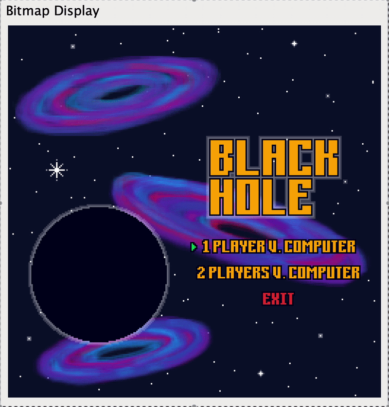
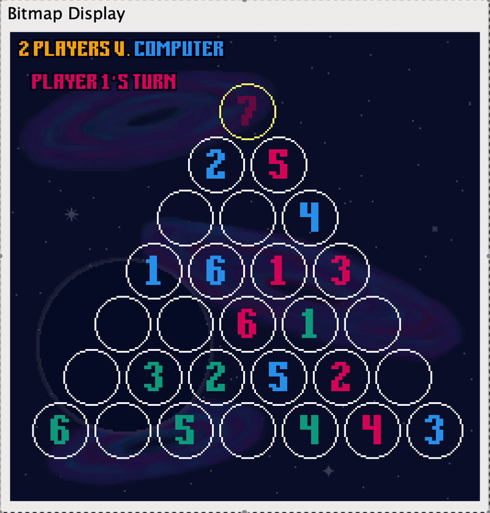
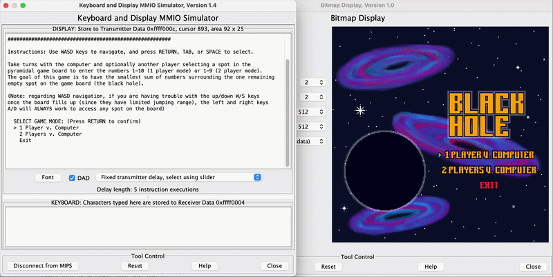

# MIPS Assembly Black Hole Game

A MARS MIPS assembly implementation of the board game Black Hole. Features an animated home screen, text-based and graphical gameplay modes, and WASD-controlled movements.

## How to run

This program uses syscalls specific to [MARS (*MIPS Assembler and Runtime Simulator*)](https://dpetersanderson.github.io/download.html), so you'll need to install the MARS IDE to run it. If you don't already have MARS and/or Java installed, follow the instructions on the linked page to download them.

Now, you can run the program:
1. Clone this repo to your local machine (if you use sparse checkout, you just need the `src/` directory)
2. Open `driver.asm` in the MARS IDE.
3. In MARS, open Settings and enable ***Assemble all files in directory*** if it isn't already.
4. Assemble (**F3**) and Run (**F5**) the program.
5. Follow the instructions printed to the standard output to connect the Bitmap Display and Keyboard and Display MMIO Simulator tools to MARS.

For additional guidance, see [`docs/User_manual.pdf`](docs/User_manual.pdf).

## Further Documentation

For a more detailed explanation of features, algorithms, implementation techniques, and program structure, see my [project report](docs/Project_report.pdf). For documentation on the tool I wrote to convert PNG image data into arrays of colors in `.asm` files for the graphical interface, check out the README in the [`tools/generate-graphics/`](tools/generate-graphics/) directory.

Each source file also has a header comment describing its purpose, along with inline comments describing implementation details.

## Full Game Demo

## Project Background

This project was created for my final project for CS 2340 (computer architecture).
